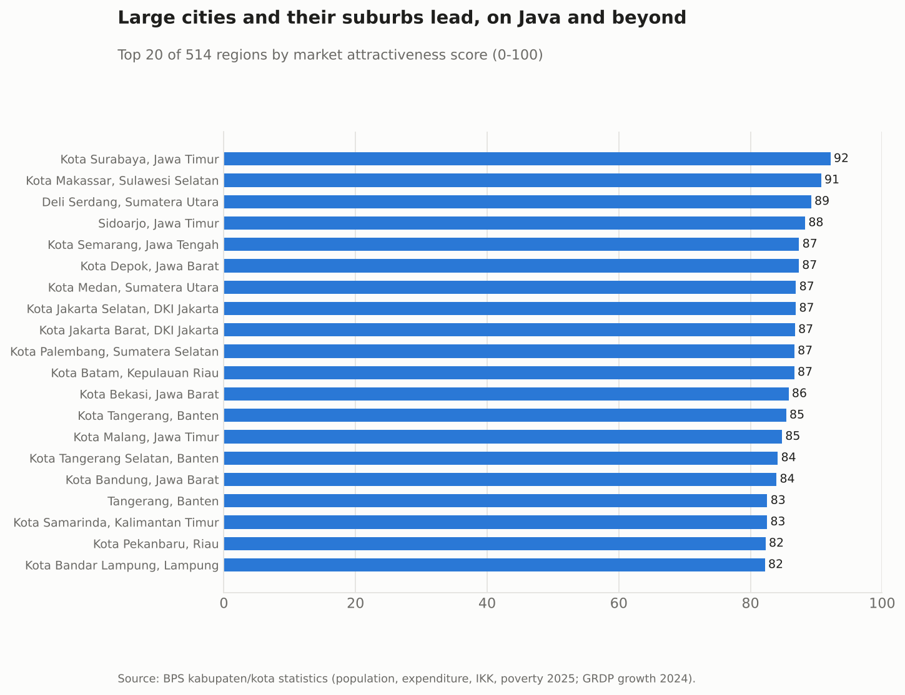
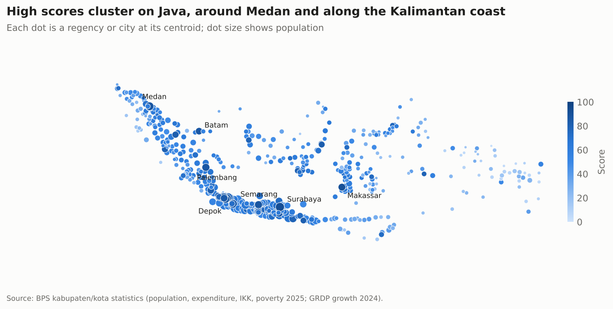
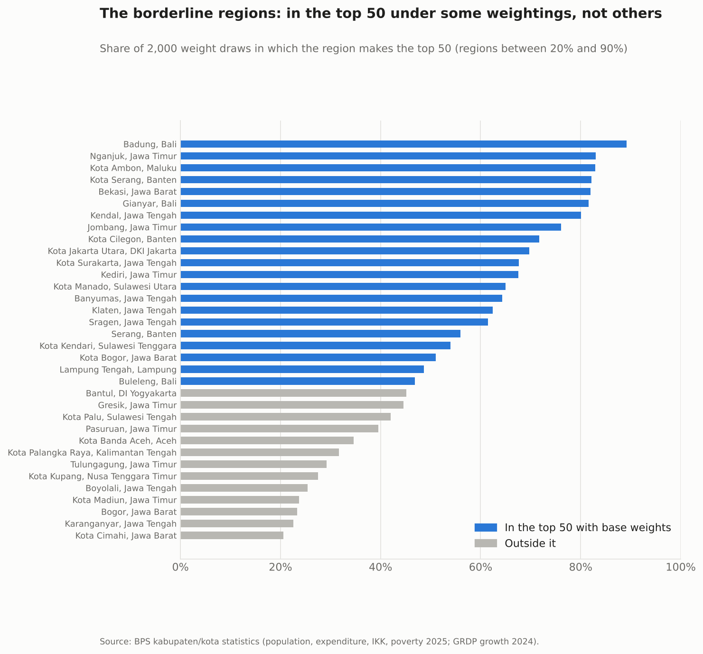
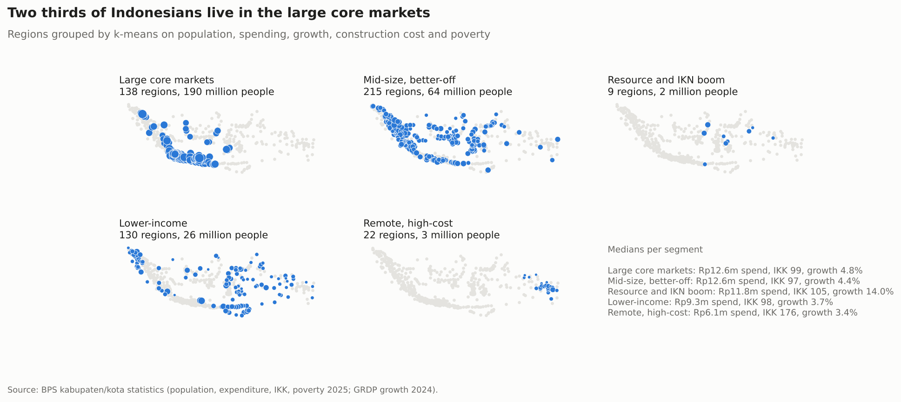
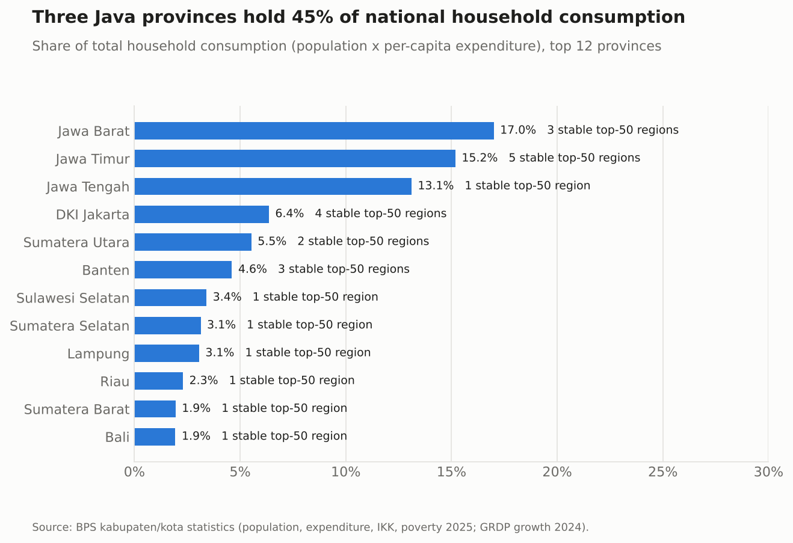

# Where to grow a building-materials distributor

A market attractiveness ranking of Indonesia's 514 regencies and cities, built from BPS statistics. The question behind it comes from my work at a cement distributor: if you can open one more branch or add one more sales team, which areas should come first?

The full walkthrough with code is in [`notebooks/market_sizing.ipynb`](notebooks/market_sizing.ipynb).

## The score

Each region gets a percentile rank on five indicators, and the ranks are combined with fixed weights:

| Factor | Indicator (BPS) | Weight |
|---|---|---|
| Market size | Population 2025 | 0.35 |
| Purchasing power | Adjusted per-capita expenditure 2025 | 0.30 |
| Momentum | Real GRDP growth 2024 | 0.15 |
| Cost to serve | Construction cost index (IKK) 2025, lower is better | 0.10 |
| Poverty | Poverty rate 2025, lower is better | 0.10 |

Percentile ranks keep outliers from taking over the score: Morowali's 2024 growth and the highest IKK values in Papua are several times the national median.

## Findings

**Large cities and the regencies around them lead.** Surabaya, Makassar, Deli Serdang, Sidoarjo and Semarang make the top five. All of them have more than 1.4 million people, spending above the national median and construction costs close to the national average. Eight of the top 20 are outside Java, from Medan and Batam to Samarinda and Makassar.





**29 of the top 50 hold up whatever the weights.** The score was recomputed with 2,000 random weight sets drawn around the base weights. 29 regions are in the top 50 in at least 90% of the runs. The others move in and out depending on how much size counts against spending. Bogor regency is the clearest case: it is the most populous region in the country (5.7 million) but has lower spending per person, and it reaches the top 50 in only 23% of runs.



**Five kinds of market.** K-means on the same five indicators separates:

| Segment | Regions | People | Median spending (Rp m/yr) | Median IKK | Median growth 2024 |
|---|---|---|---|---|---|
| Large core markets | 138 | 190 m | 12.6 | 99 | 4.8% |
| Mid-size, better-off | 215 | 64 m | 12.6 | 97 | 4.4% |
| Resource and IKN boom | 9 | 2 m | 11.8 | 105 | 14.0% |
| Lower-income | 130 | 26 m | 9.3 | 98 | 3.7% |
| Remote, high-cost | 22 | 3 m | 6.1 | 176 | 3.4% |

Two thirds of the population lives in the first group. The nine boom regions (nickel in Sulawesi and North Maluku, the new capital in Penajam Paser Utara) are small but are where construction is growing fastest. The 22 remote regions, mostly in Papua's highlands, have construction costs 76% above the national average and a median poverty rate of 31%.



**Java holds 58% of household consumption.** Jawa Barat, Jawa Timur and Jawa Tengah alone account for 45%. Jawa Timur has the most regions that are stable top-50 picks (5).



## What I would do with this

- Use the 29 stable regions as the shortlist, and check them against current branch coverage and sales.
- Treat the borderline regions as a second list that needs local information: competitors, road access, existing distributors.
- Watch the boom regions separately. Their household numbers are small, but project demand (smelters, the capital) does not show up in a household-based score.

## Limits

The score only uses household-side public data. A real decision would add sales history, competitor presence, logistics cost and cement consumption per region, none of which is public at this level. Growth is for 2024 while the other indicators are for 2025, and map positions are region centroids.

## Run it

```bash
pip install -r requirements.txt
jupyter notebook notebooks/market_sizing.ipynb
```

The data is included in `data/raw/`. The notebook writes charts to `images/` and tables to `results/`.

## Layout

```
notebooks/market_sizing.ipynb   the analysis
src/chart_style.py              shared chart settings
data/raw/                       BPS indicators by region, see data/README.md
results/                        scores, weight sensitivity, segments, provinces
images/                         charts
```

## Data

BPS (Statistics Indonesia) regency and city statistics, as compiled in [bilbobib/IPM-Viz](https://github.com/bilbobib/IPM-Viz) (2025 indicators) and [ariantobarus123/uas-visdat-stis-2026](https://github.com/ariantobarus123/uas-visdat-stis-2026) (2024 growth and coordinates). The BPS table for each column is listed in `data/raw/bps_kabkota_2025_sources.csv`.
